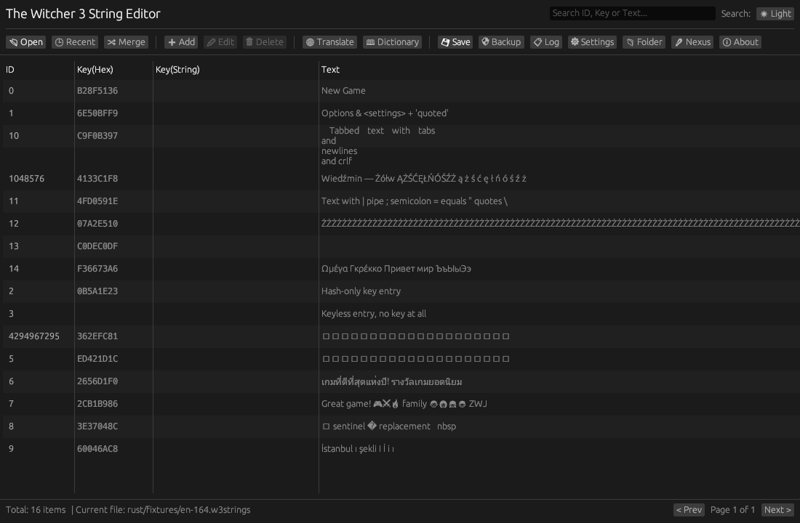
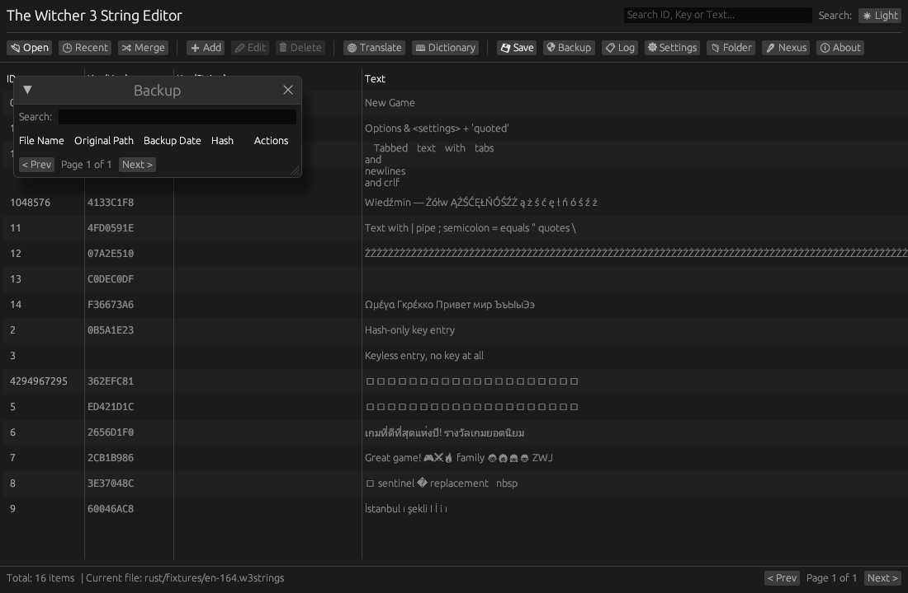
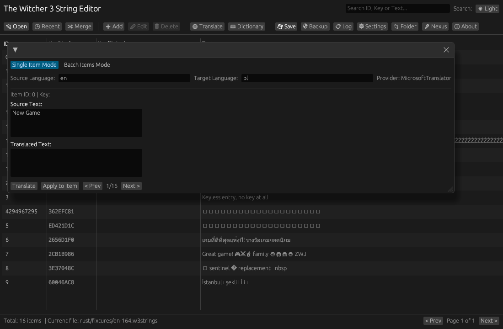

# Witcher 3 String Editor (Rust Edition)

[](https://www.rust-lang.org/)
[](https://github.com/emilk/egui)
[](rust/app-cases/replay-report.md)
[](LICENSE)

A high-performance desktop tool for editing string resources in *The Witcher 3: Wild Hunt*, enabling modification of in-game dialogues, quest descriptions, names, and UI elements. 

Originally built in C# (.NET/WPF), this project has been rewritten into **100% pure, safe Rust** with a responsive **`egui`/`eframe`** desktop graphical interface.

---

## Highlights

- **Pure Safe Rust**: Zero unsafe code (`#![forbid(unsafe_code)]`), compiled to a single native binary with no external runtime dependencies (.NET is no longer required).
- **Byte-Exact `.w3strings` Codec**: Native in-process encoding and decoding for both UTF-16LE (`v162`) and UTF-8 (`v164`) containers. Exactly matches CD Projekt Red's original Murmur3 32-bit localization key hashing and obfuscation bit-flips.
- **Fast Desktop GUI (`egui`)**: Responsive, hardware-accelerated interface supporting native Linux Wayland & X11 with instant Dark / Light theme toggling.
- **Native Drag-and-Drop**: Drop any `.w3strings`, `.csv`, or `.xlsx` file directly onto the application to load it instantly.
- **Multi-Format Serialization**:
  - **`.w3strings`**: Native game binary formats (`v162` UTF-16, `v164` UTF-8).
  - **`.csv`**: Pipe-delimited text (`ID|KeyHex|KeyName|Text`) with comment skipping.
  - **`.xlsx`**: Cell-equivalent Excel import and export styled with headers and freeze panes (powered by `calamine` and `rust_xlsxwriter`).
- **Comprehensive Dialog Suite**:
  - **Save & Export**: Format, language culture, and output directory selection.
  - **String Merge**: Merge external translations into existing string tables by matching IDs while preserving untouched keys.
  - **Add & Edit**: In-place string editing with automatic String ID generation and change tracking.
  - **Settings**: Encrypted key settings, default output directory, preferred encoding, page size, and interface language.
  - **Backup Manager**: Automatic backups on save with SHA-256 deduplication, preview, delete, and instant restore.
  - **Recent Files**: MRU file tracking with search, quick open, and favoriting (pin/unpin).
  - **Dictionary Manager**: Custom `.txt` word replacement dictionaries with high-speed multi-pattern replacement via `aho-corasick`.
  <!-- coderabbit-ai-generated:v1 -->

<!-- coderabbit-ai-generated-section:v1:8b15cd57a6adc8cb800cc55f02128d1642d736d246e3c76440b9f72577509dee -->

- **Translation Helper**: Translate one item or a batch in the background with Google or Microsoft. The app reports provider failures without sending text to another provider. Yandex is currently unavailable.

<!-- /coderabbit-ai-generated:v1 -->
  - **Log Viewer**: Real-time thread-safe log buffer with severity filtering and log export.
  - **About Window**: Displays version information and checks for NexusMods updates.
- **12 Localized Languages**: Full UI translations for English, Polish, German, French, Spanish, Italian, Russian, Japanese, Simplified Chinese, Traditional Chinese, Korean, and Brazilian Portuguese (1,968 localized strings).

---

## Screenshots

  
*Main interface with virtualized string entries, live search, and pagination*

  
*Backup management with restore and delete options*

  
*Built-in translation helper with single-item and batch processing*

---

## Installation & Running

### Prebuilt Binary (Linux x86_64)

1. Download the latest release tarball from [GitHub Releases](https://github.com/0xra0/Witcher3StringEditor/releases).
2. Extract the archive:
   ```bash
   tar -xzf witcher3-string-editor-v2.1.0-linux-x86_64.tar.gz
   ```
3. Run the executable:
   ```bash
   ./witcher3-string-editor
   ```

### Building from Source

Requires standard Rust (1.80+):

```bash
# Clone repository
git clone https://github.com/0xra0/Witcher3StringEditor.git
cd Witcher3StringEditor

# Run the egui GUI application
cargo run --manifest-path rust/app/Cargo.toml --release --bin witcher3-string-editor

# Run characterization tests
cargo test --manifest-path rust/w3codec/Cargo.toml
cargo test --manifest-path rust/settings/Cargo.toml
cargo test --manifest-path rust/locales/Cargo.toml
cargo test --manifest-path rust/dictionary/Cargo.toml
cargo test --manifest-path rust/services/Cargo.toml
cargo test --manifest-path rust/xlsx/Cargo.toml
cargo test --manifest-path rust/translate/Cargo.toml
cargo test --manifest-path rust/nexus/Cargo.toml
cargo test --manifest-path rust/app/Cargo.toml
```

---

## Verification & Characterization Metrics

The Rust port was characterized against the original C# implementation across 219 comprehensive test cases:

```
219/219 cases passed (100.0%)
Fallback rate: 0.0% (0/219 cases answered by original)
All tests green. Zero compiler or clippy warnings under -D warnings.
```

Detailed test logs can be found in [rust/app-cases/replay-report.md](rust/app-cases/replay-report.md).

---

## Architecture

The Rust workspace consists of 9 modular crates:

| Crate | Directory | Description |
|---|---|---|
| `w3codec-rs` | `rust/w3codec` | Byte-exact `.w3strings` v162/v164 codec, CSV serializer, key hash algorithm |
| `settings-rs` | `rust/settings` | Byte-exact `AppSettings` JSON serializer & parser |
| `locales-rs` | `rust/locales` | 12 language localization tables (1,968 strings) and `CultureResolver` |
| `dictionary-rs` | `rust/dictionary` | Custom `.txt` dictionary parser and Aho-Corasick dynamic replacer |
| `services-rs` | `rust/services` | Linux XDG AppPaths, SHA-256 BackupService, RecentFiles, LogAccess |
| `xlsx-rs` | `rust/xlsx` | Excel workbook reader (`calamine`) and styled writer (`rust_xlsxwriter`) |
| `translate-rs` | `rust/translate` | Asynchronous translation client (Google, Bing, Yandex) |
| `nexus-rs` | `rust/nexus` | NexusMods GraphQL client for automatic update checking |
| `app` | `rust/app` | Native desktop GUI binary (`witcher3-string-editor`) and CLI `harness` |

*Note: The original C# WPF codebase is retained in the root repository for reference and historical parity testing.*

---

## License

Licensed under the [MIT License](LICENSE).
